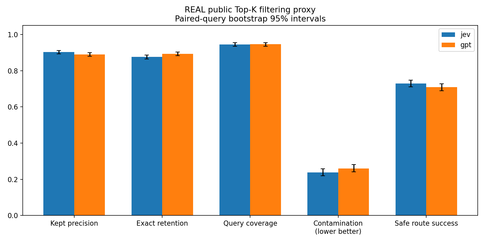
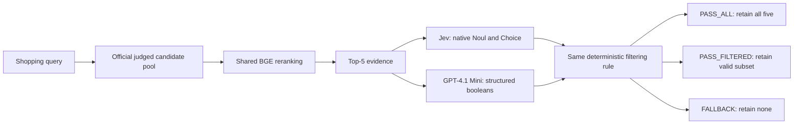

# CRAG Gate Benchmark: Jev vs. GPT-4.1 Mini

[](https://github.com/Tue2day/crag-gate-benchmark/actions/workflows/ci.yml)
[](LICENSE)
[](pyproject.toml)

**Can Jev replace GPT-4.1 Mini as the product-filtering and routing gate in a corrective RAG workflow?**

This repository evaluates that engineering decision on **Amazon ESCI**, with a shared **BGE reranker**, real OpenRouter requests, and separate calibration and held-out test queries. It publishes the evidence—including the failed acceptance condition—rather than presenting a deployment claim.

> **Main finding:** On 2,000 held-out queries, calibrated Jev improved retained-item precision by **1.32 percentage points**, reduced observed Gate P95 latency by **52.7%**, and reduced measured API cost by **70.2%**. Exact-match retention fell by **1.72 points**. Although the point estimate is within a 2-point allowance, the one-sided 95% bound is **−2.65 points**: **retention non-inferiority was not established, so the production-replacement acceptance test did not pass.**

[Full experiment report](docs/EXPERIMENT_REPORT.md) · [Reproduction guide](docs/REPRODUCIBILITY.md) · [Prompts and output contract](docs/PROMPTS.md) · [Validation](docs/VALIDATION.md) · [Release artifacts](https://github.com/Tue2day/crag-gate-benchmark/releases/tag/v0.7.0)

## Results at a glance

The main experiment uses **800 calibration queries** and **2,000 independent natural test queries**, each with five reranked candidates. The threshold was frozen at **0.35** before test API calls. Both methods completed all 2,800 query evaluations after retries.

| Measure | Jev, calibrated | GPT-4.1 Mini | Interpretation |
|---|---:|---:|---|
| Retained-item precision ↑ | **90.33%** | 89.01% | Difference +1.32pp; paired 95% CI [+0.69, +1.93]pp |
| Exact-match retention ↑ | 87.60% | **89.32%** | Difference −1.72pp; non-inferiority not established |
| Passed queries containing a non-Exact item ↓ | **23.85%** | 25.99% | Query contamination, not item false-positive rate |
| Safe routing success ↑ | **72.95%** | 70.90% | Valid nonempty subset when Exact exists; fallback otherwise |
| Successful HTTP P50 / P95 ↓ | **134 / 241 ms** | 1,885 / 2,356 ms | Network/provider request duration |
| Gate P50 / P95 ↓ | **1,013 / 1,138 ms** | 1,907 / 2,409 ms | Includes invocation-level rate-limit waiting and retries |
| Total measured API cost ↓ | **$0.7360** | $2.4670 | Calibration + test + known retry charges, 2,800 queries/model |

Quality and latency are measured on the **test set**. Cost covers the **entire round**. Values are rounded for readability; [machine-readable results](benchmarks/v5/metrics.json) retain precision. Gate timing excludes the task queue, shared BGE reranking, retrieval, answer generation, and manual restart downtime. It is **not end-to-end RAG latency**.



## What the gate does



For each candidate, the models assess:

1. Whether the core product type/function matches the query.
2. Whether it is an accessory trap for a requested main product.
3. Whether an explicit attribute constraint is violated or unsupported.

A candidate is retained only when **core intent matches**, **accessory trap is false**, and **constraint category is `NONE`**. Relative order is preserved. A wrong Top-1 does not force fallback if a later candidate can be retained.

Jev returns ten native Noul values and five Choice judgments in **one HTTP request** per query. GPT returns the corresponding booleans and categories, with a short reasoning log. No fusion model, fine-tuning, or learned reranker/API combination is used in the main comparison. The calibrated parameter is only Jev's core-intent threshold; accessory and constraint rules remain fixed.

The implementation reranks **already-judged candidate pools**. It does not implement or claim full-catalog vector retrieval, answer generation, or an exact reproduction of a private company prompt.

## Quick start: verify the published results for free

No API key, GPU, dataset download, or model weights are required for verification.

```text
git clone https://github.com/Tue2day/crag-gate-benchmark.git
cd crag-gate-benchmark
python -m pip install -e ".[dev]"
python -m jev_gate verify-results --experiment v5
python -m jev_gate verify-results --experiment v4
python -m pytest -q
```

Use Python **3.11 or 3.12**. A virtual environment is recommended; the same commands work in an activated Conda environment. Commands do not require Bash.

The verifier checks export hashes, five-candidate pairing, native decisions, the calibration-selected threshold, confusion/query counts, all seven paired bootstrap difference intervals, the one-sided retention bound, recorded latency quantiles, and usage totals. It makes **zero network requests** and never loads credentials.

To additionally validate native API responses, download the detailed ZIP from the release and pass its path:

```text
python -m jev_gate verify-results --experiment v5 --raw-artifacts crag-gate-benchmark-v0.7.0-artifacts.zip
```

Verification replays recorded evidence. It does not regenerate new cloud-model predictions or reproduce network timing on your computer.

## Run a fully offline simulation

Mock results are isolated under a `mock` directory and clearly labeled. They test pipeline mechanics and are **not benchmark scores**.

```text
python -m jev_gate prepare --config config.mock.toml --mock
python -m jev_gate rerank --config config.mock.toml --mock
python -m jev_gate preflight --config config.mock.toml --mock
python -m jev_gate api-all --config config.mock.toml --splits calibration --mock
python -m jev_gate freeze-thresholds --config config.mock.toml --mock
python -m jev_gate api-all --config config.mock.toml --splits test --mock
python -m jev_gate evaluate --config config.mock.toml --mock
```

## Rerun the real experiment

A real rerun is a **new paid experiment**, not necessary to inspect this project. Provider availability, prices, model behavior, and network timing can change.

1. Install the base project and reranking dependencies. Install a CUDA-compatible PyTorch build using the official [PyTorch instructions](https://pytorch.org/get-started/locally/) if using an NVIDIA GPU. The recorded run used an RTX 4090 **Laptop** GPU with 16 GB VRAM; this is not a desktop 24 GB 4090 measurement.
2. Create a local `.env` file beside the configuration, containing `OPENROUTER_API_KEY=...`. Do not commit it. Leave it absent for offline work.
3. Follow the staged commands below. Downloading data or model weights uses network/storage; API inference spends OpenRouter credit.

```text
python -m pip install -e ".[rerank,dev]"
python -m jev_gate doctor --config config.topk-calibrated-v5.toml
python -m jev_gate download-data --config config.topk-calibrated-v5.toml
python -m jev_gate prepare --config config.topk-calibrated-v5.toml
python -m jev_gate rerank --config config.topk-calibrated-v5.toml
python -m jev_gate preflight --config config.topk-calibrated-v5.toml
python -m jev_gate api-all --config config.topk-calibrated-v5.toml --splits calibration
python -m jev_gate freeze-thresholds --config config.topk-calibrated-v5.toml
python -m jev_gate api-all --config config.topk-calibrated-v5.toml --splits test
python -m jev_gate evaluate --config config.topk-calibrated-v5.toml
```

Portable manifests pin the original ESCI commit, Parquet SHA-256 values, prior-query exclusions, and prepared split membership. You do **not** need the author's old directories or previous paid runs. The local `data` and `runs` directories remain ignored by Git.

The real preflight checks the requested fixed models, current quoted prices, available credit, and a request-size-adjusted estimate derived from historical receipts. The recorded configuration has a **$4.20 budget**, **$0.10 safety reserve**, and **$4.05 forecast ceiling** including 25% contingency. Each model uses **concurrency 2** and **2 requests/second**. No feasible calibration threshold means the test phase stops; missing models, changed prices, insufficient funds, and missing data do not trigger a substitute model, reduced sample, or mock fallback.

The historical run cost **$3.203045418** in total. This is a recorded observation, not a price guarantee. See the [reproduction guide](docs/REPRODUCIBILITY.md) for resuming, provider errors, manifest handling, and artifact locations.

## Five rounds, one focused presentation

| Round | Task | Natural test queries | What it established |
|---|---|---:|---|
| 1 | At least one Exact item in Top-5 | 500 | Too easy for a 5% risk target; only ten negative test queries |
| 2 | Top-1 Exact gating; five methods | 1,000 | Ranking signal improved; frozen risk targets were not achieved |
| 3 | Fusion gates with independent risk audit | 4,000 | Independent certification failed; diagnostic gains did not override that result |
| 4 | Pure-model Top-5 filtering/routing, fixed threshold | 500 + 100 challenge | Higher precision came with lower Exact retention |
| **5** | **Calibrated pure-model Top-5 filtering/routing** | **2,000** | **Precision/cost/latency advantages; 2pp retention non-inferiority not established** |

Rounds 4 and 5 use different held-out queries. Their point estimates are **not a controlled threshold ablation**. Earlier AP, calibration, and risk/coverage results address different tasks and are not mixed into a single leaderboard. Full data-quality and statistical context appears in the [report](docs/EXPERIMENT_REPORT.md).

## Repository map

```text
jev_gate/              Experiment CLI, API clients, metrics, portable manifests, verifier
benchmarks/v4/         Supporting fixed-threshold experiment and derived evidence
benchmarks/v5/         Main calibrated experiment and derived evidence
manifests/             Dataset identity, prior exclusions, exact splits, cost profile
docs/                  English report, reproduction guide, prompt contract
scripts/               Recorded-run audit and monitoring helpers
tests/                 Offline regression and publication checks
third_party/           ESCI license and notice
```

GitHub Actions runs offline tests and both result verifiers on Linux and Windows with Python 3.11/3.12. CI never makes paid model requests. Historical frozen source snapshots are included in the detailed release so publication-time portability changes are distinguishable from the code that generated the observations.

## Limitations and production decision

- The pre-specified **joint acceptance condition failed**. This evidence supports further evaluation, not unconditional production replacement.
- Calibration came from the official training source; testing came from the official test source. The observed retention gap increased across those sources.
- ESCI Exact judgments are the eligibility proxy. Diagnostic core/accessory/constraint fields have no separate human gold labels; `Complement` is not automatically an accessory-trap label.
- The experiment evaluates filtering/routing, not downstream answer correctness, live user outcomes, load-test SLAs, or full-system retrieval quality.
- Confidence intervals are conditional on the selected threshold and do not incorporate calibration-selection uncertainty.
- API retries and a clock-skew observation are disclosed. Successful completion is not first-attempt reliability. Human audit sheets remain unreviewed.

## Attribution and license

Original project code is released under the [MIT License](LICENSE). ESCI-derived labels, identifiers, and examples retain the upstream **Apache-2.0** terms and [Amazon notice](third_party/ESCI-NOTICE); see [third-party attribution](third_party/README.md). BGE weights are downloaded separately and governed by their own license. Hosted model services remain subject to their providers' terms.

Sources: [Amazon ESCI dataset and paper citation](https://github.com/amazon-science/esci-data), [BGE reranker model card](https://huggingface.co/BAAI/bge-reranker-v2-m3), [OpenRouter API documentation](https://openrouter.ai/docs), [TypeSafe System One](https://docs.typesafe.ai/api/system-one).

To cite this specific benchmark, use [CITATION.cff](CITATION.cff) and the `v0.7.0` release. Please retain the failed non-inferiority finding when summarizing these results.
