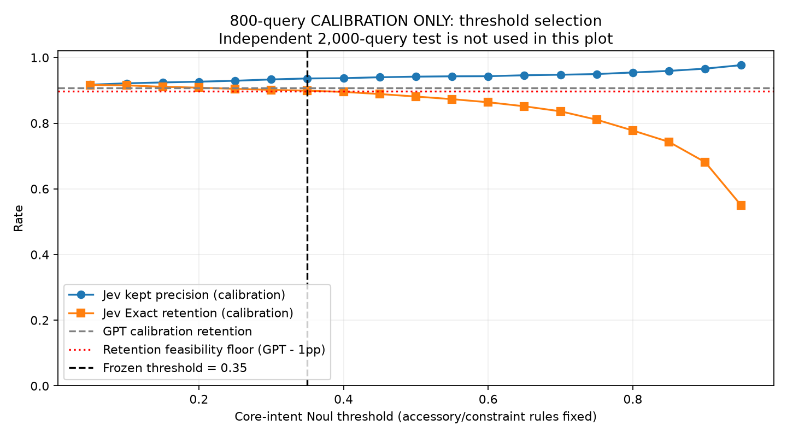

# Evaluating Jev as a CRAG Product-Filtering Gate

**A reproducible comparison with GPT-4.1 Mini on Amazon ESCI**
Release: **v0.7.0** · Recorded experiments: **October 25–26, 2026**
Main study: **800 calibration queries + 2,000 independent test queries**

## Contents

1. [Executive summary](#1-executive-summary)
2. [Research question and acceptance criteria](#2-research-question-and-acceptance-criteria)
3. [Data and experimental units](#3-data-and-experimental-units)
4. [Systems, evidence, and routing](#4-systems-evidence-and-routing)
5. [Calibration and freezing](#5-calibration-and-freezing)
6. [Metrics and statistical analysis](#6-metrics-and-statistical-analysis)
7. [Held-out quality results](#7-held-out-quality-results)
8. [Latency, reliability, and cost](#8-latency-reliability-and-cost)
9. [Supporting fixed-threshold study](#9-supporting-fixed-threshold-study)
10. [Error cases and interpretation](#10-error-cases-and-interpretation)
11. [Five-round research history](#11-five-round-research-history)
12. [Validity, production decision, and reproduction](#12-validity-production-decision-and-reproduction)

## 1. Executive summary

This project asks whether **Jev can serve as a more efficient alternative to GPT-4.1 Mini at the filtering/routing stage of a corrective retrieval-augmented generation workflow**. The motivating application is a gate that receives a shopping query and reranked products, removes unsuitable candidates, and either passes the retained results or requests fallback. The study reconstructs a public proxy for that interface; it does not reproduce a private production prompt or evaluate a deployed replacement.

In the final study, a single Jev core-intent threshold was selected on **800 fresh calibration queries**, then frozen before both models processed **2,000 separate natural test queries**. Both models received the same five candidates, product attributes, and reranker scores. There was no fusion model or fine-tuning. Native API responses, retries, costs, and source/data fingerprints were preserved.

The observed tradeoff is:

- Jev retained-item precision: **90.33%**, versus **89.01%** for GPT; difference **+1.32 percentage points**, with paired 95% CI **[+0.69, +1.93]pp**.
- Jev Exact-match retention: **87.60%**, versus **89.32%**; difference **−1.72pp**. The **one-sided 95% lower bound is −2.65pp**, below the allowed −2pp boundary.
- Recorded Gate P95: **1.138s**, versus **2.409s**, a **52.7% reduction** under the specified concurrency/rate limit.
- Whole-round measured API charges: **$0.736013418**, versus **$2.467032000**, a **70.2% reduction**.

**The pre-specified joint acceptance condition did not pass.** Precision superiority was supported, but Exact-retention non-inferiority was not established. A point estimate inside the 2pp allowance is insufficient when its uncertainty still includes a larger loss. This also does not prove that the true loss necessarily exceeds 2pp. These distinctions are important to the production decision.

## 2. Research question and acceptance criteria

### 2.1 Practical decision

The baseline is GPT-4.1 Mini acting on query + Top-K evidence. A replacement must be evaluated on both retained-result quality and operational cost. A model that simply rejects more products can improve precision while harming useful-product retention; reporting only precision would obscure that tradeoff.

The primary question is therefore:

> After independently calibrating Jev, does it improve retained-item precision while keeping Exact-retention loss below an allowed 2 percentage points on unseen queries?

The gate may retain a valid lower-ranked candidate even if Top-1 is incorrect. Blanket rejection based only on Top-1 does not represent this task.

### 2.2 Pre-specified tests

The final test required **both**:

| Requirement | Frozen criterion | Result |
|---|---|---|
| Retention non-inferiority | One-sided 95% lower bound for Jev−GPT Exact retention **> −2pp** | **Not established:** −2.65pp |
| Precision superiority | Two-sided 95% CI lower bound for Jev−GPT precision **> 0** | **Supported:** +0.69pp |

A formal positive statement also required common-success coverage of at least 99% and at least 50 natural test queries containing non-Exact candidates. The actual test had 100% common success and 812 queries containing at least one non-Exact candidate.

These are conjunctive conditions, not a search over several endpoints for a favorable p-value. Other routing, contamination, F1, and error-category results are supporting analyses. This study does **not** certify a 2% or 5% query-risk guarantee.

### 2.3 Scope of freezing

Protocol/configuration/source fingerprints were saved before calibration calls. The threshold and calibration-record fingerprints were saved before test calls, and the program checked them before allowing test execution. No grid expansion, prompt change, or threshold adjustment was made after inspecting this test set.

“Pre-specified” and “frozen” refer to those local experiment controls. This was **not an externally registered or independently timestamped preregistration**. The public GitHub release was prepared after the experiment.

## 3. Data and experimental units

### 3.1 Dataset identity

The source is the [Amazon Shopping Queries Dataset (ESCI)](https://github.com/amazon-science/esci-data), pinned to commit `7916cdf6ab75a462e77f20ab40428a10923998d5`. The two original Parquet SHA-256 values are published in the [dataset manifest](../manifests/dataset.json).

Only US-locale query/product judgments with usable product metadata are used. Candidate pools have at least five valid judged products. Duplicate query/product entries are removed, conflicting labels are rejected, and normalized query text is deduplicated across source and experimental sets.

The code reads the full relevant US pool; it does **not** select only the reduced `small_version` task-1 benchmark. The resulting metrics are specific to this gate task and are not official ESCI ranking scores.

The eligibility proxy is:

- **E / Exact:** eligible for retention.
- **S / Substitute, C / Complement, I / Irrelevant:** ineligible under the strict Exact-only objective.

This is intentionally stricter than a shopping application that accepts substitutes. A Complement label does not independently establish that a model's accessory-trap field is correct.

### 3.2 Split design

| Set | Source | Queries | Candidate judgments after reranking | Role |
|---|---|---:|---:|---|
| Calibration | Official training source | 800 | 4,000 | Select Jev's core threshold |
| Natural test | Official test source | 2,000 | 10,000 | One final frozen-policy comparison |

Seed: **2026102605**. No negative enrichment, query rewriting, or challenge construction was performed in round 5. All **25,680** normalized query texts prepared in the previous four rounds were excluded, including previously unused development/challenge reservations.

Normalization is Unicode NFKC, case folding, and whitespace collapse. The published exclusion hashes, prepared membership, original candidate-pool fingerprints, and replay order are retained so a rerun does not require previous paid experiments or private absolute paths.

Calibration contained **3,402 Exact candidates** (85.05%). The test contained **8,126 Exact** and **1,874 non-Exact** candidates (81.26% Exact), across 2,000 queries. Of the test queries, 1,956 had at least one Exact result and 44 had none. Calibration/test source differences are relevant to interpreting why the retention gap did not remain identical.

### 3.3 Reranking and evidence truncation

All candidates in each judged pool were scored by `BAAI/bge-reranker-v2-m3`, commit `953dc6f6f85a1b2dbfca4c34a2796e7dde08d41e`. The top five were retained in descending raw-score order, with product ID as deterministic tie-breaker.

The recorded configuration used CUDA FP16, batch size 8, and a maximum tokenized pair length of 512. Candidate text used title, brand, color, and bullet points. The title was limited to 300 characters and bullet points to 500 characters. Missing fields were not filled with fabricated evidence.

The API inputs included the same query, ranks, product IDs, truncated attributes, and raw cross-encoder scores. Scores were explicitly described as uncalibrated signals. Gold labels, dataset split names, and construction/derived-label fields were not sent to either API.

**This is reranking inside judged pools, not full-catalog retrieval.** Upstream recall and downstream answer generation are outside the experiment.

## 4. Systems, evidence, and routing

### 4.1 Model interfaces

| Property | Jev | GPT-4.1 Mini |
|---|---|---|
| Requested model | `typesafe/jev-1.13-20260917` | `openai/gpt-4.1-mini` |
| Recorded provider | TypeSafe | OpenAI |
| Gateway | OpenRouter | OpenRouter |
| Response mechanism | Native Noul and Choice | Strict JSON booleans/categories |
| Per-query HTTP request | One, containing 15 questions | One structured-output request |
| Generated explanation | Structured audit log only | Brief overall reasoning log, requested ≤40 words |
| Downstream use of explanation | None | None |

The GPT identifier is a fixed hosted API ID, not an independently inspectable weight commit. The experiment records requested/resolved IDs and providers but does not claim frozen hosted weights.

For each of five candidates, Jev answers two Noul questions—core intent and accessory trap—and one Choice question for the primary constraint category. GPT returns the corresponding native booleans and enum, with temperature 0 and a 768-token output ceiling. It is not forced to produce probabilities, and no token-logprob interpretation is made.

The [prompt contract](PROMPTS.md) contains the complete shared rules, questions, constraint definitions, GPT system message, output schema, and representative evidence structure. Identical semantic criteria and evidence do not imply identical serialization, token counts, explanations, or internal model computation.

### 4.2 Deterministic filter and router

For candidate i, let c_i be Jev's native core Noul and a_i its accessory Noul. With core threshold t:

```text
Jev keep(i) = (c_i >= t) AND (a_i < 0.5) AND (constraint_i == NONE)
GPT keep(i) = core_bool_i AND NOT accessory_bool_i AND (constraint_i == NONE)
```

`UNKNOWN` means an explicit attribute cannot be verified from the supplied evidence. It is not recorded as a confirmed violation, but it prevents direct retention. At most one primary violation category is selected; this is not an exhaustive free-text constraint list.

Routing is shared and deterministic:

| Retained subset | Action |
|---|---|
| All five candidates | `PASS_ALL` |
| A nonempty subset | `PASS_FILTERED` |
| No candidates | `FALLBACK` |

Relative BGE order is preserved. No fusion classifier, learned reranker/API combination, fine-tuning, query rewrite agent, or generated-answer evaluator is involved in the main comparison.

## 5. Calibration and freezing

### 5.1 One-dimensional search

Only Jev's core threshold was adjustable. The accessory threshold and constraint rule remained fixed. The grid was **0.05, 0.10, …, 0.95**.

A calibration threshold was feasible if:

```text
Jev calibration Exact retention >= GPT calibration Exact retention - 0.01
```

Among feasible points, the rule selected the highest retained-item precision, breaking ties toward the larger threshold. If no point was feasible, the protocol would stop before test inference rather than change the grid, rules, seed, or sample.

The 1pp calibration slack was a selection buffer; the **2pp test non-inferiority margin was a separate acceptance condition**. Satisfying the former does not imply passing the latter.

### 5.2 Observed selection

GPT calibration Exact retention was **90.74%**, so the feasibility floor was **89.74%**.

| Jev threshold | Calibration precision | Calibration Exact retention | Feasible |
|---:|---:|---:|---|
| 0.05 | 91.73% | 91.65% | Yes |
| 0.25 | 92.93% | 90.48% | Yes |
| 0.30 | 93.34% | 90.15% | Yes |
| **0.35** | **93.63%** | **89.92%** | **Selected** |
| 0.40 | 93.72% | 89.54% | No |
| 0.50 | 94.19% | 88.12% | No |
| 0.95 | 97.70% | 54.91% | No |

The full grid is in [calibration_grid.csv](../benchmarks/v5/calibration_grid.csv). Jev's calibration retention gap at the chosen point was **−0.82pp**. GPT calibration precision was 92.26%.



The fixed accessory/constraint rules rejected 284 of the 3,402 calibration Exact candidates. Even accepting every core score could therefore retain at most **91.65%** under those unchanged rules. This is a calibration-only diagnostic ceiling, not a held-out score or an excuse to alter those rules after the test.

### 5.3 Frozen evidence

The selected threshold was 0.35 before test API calls. Raw Jev records preserve the original default-0.5 booleans; final round-5 metrics separately apply the frozen threshold to the native core probability. Evaluating nineteen local thresholds reused the same 800 Jev responses and did not make nineteen sets of API calls.

The original machine stored protocol/source, prepared/ranked-data, and calibration-receipt fingerprints. Public exports retain those historical fingerprints separately from their new export hashes. Publication-time portability edits are not presented as the exact historical source snapshot.

## 6. Metrics and statistical analysis

### 6.1 Candidate-level metrics

Over the same 10,000 test candidate judgments for each method:

```text
TP: Exact candidate retained       FP: non-Exact candidate retained
FN: Exact candidate removed        TN: non-Exact candidate removed

Retained-item precision = TP / (TP + FP)
Exact retention         = TP / (TP + FN)
Candidate F1            = 2TP / (2TP + FP + FN)
```

Exact retention is recall over all Exact products in the Top-5, not query pass rate or original retrieval recall. Precision and risk are undefined when their denominators are zero; empty output is not automatically assigned 100% precision or 0% risk.

### 6.2 Query-level metrics

- **Coverage:** fraction of queries with a nonempty retained subset.
- **Contamination risk:** fraction of passed queries containing at least one retained non-Exact item. A single bad retained product makes that query contaminated.
- **Safe routing success:** when any Exact exists, keep a nonempty subset containing only Exact products; when no Exact exists, retain none and use fallback. It does not require retaining every Exact.
- **Unnecessary fallback:** queries with at least one Exact but an empty selected subset, divided by queries with any Exact.
- **Three-action agreement:** agreement with the oracle action derived from the complete Exact subset. It can penalize a valid partial subset differently from safe-routing success.
- **Top-1 rescue:** among queries where Top-1 is non-Exact but a later candidate is Exact, remove Top-1 and return a nonempty all-Exact subset.
- **S/C/I interception:** fraction of candidates with the given official label that are removed. It is not independently annotated accessory-detection accuracy.

### 6.3 Uncertainty

The methods are paired on the same successful queries. Each of **2,000 bootstrap draws** resamples **queries**, carrying all five candidate judgments and both methods together. Candidate rows are not treated as independent samples. The original query order and random seed are retained to replay the finite bootstrap sample exactly.

Two-sided percentile intervals use the 2.5th and 97.5th percentiles. The retention non-inferiority check uses the **5th percentile**, a one-sided 95% lower bound. Query contamination additionally has a Wilson interval. These intervals are conditional on the already selected threshold and exclude uncertainty from the calibration-selection stage, prompt design, dataset labeling, or unstudied traffic distributions.

The decision is not based on overlapping individual-model intervals, and an interval containing zero does not establish equivalence. No AP or Brier comparison is manufactured for GPT's boolean outputs in this task.

## 7. Held-out quality results

### 7.1 Primary and supporting measures

| Measure | Calibrated Jev | GPT-4.1 Mini | Jev−GPT | Paired 95% CI for difference |
|---|---:|---:|---:|---|
| Retained-item precision | **90.33%** | 89.01% | **+1.32pp** | **[+0.69, +1.93]pp** |
| Exact retention | 87.60% | **89.32%** | −1.72pp | [−2.84, −0.66]pp |
| Candidate F1 | 88.94% | 89.16% | −0.22pp | [−0.87, +0.41]pp |
| Query contamination | **23.85%** | 25.99% | −2.14pp | [−3.38, −0.89]pp |
| Query coverage | 94.55% | 94.65% | −0.10pp | [−1.15, +1.00]pp |
| Safe routing success | **72.95%** | 70.90% | +2.05pp | [+0.70, +3.40]pp |
| Top-1 rescue | 10.97% | 11.61% | −0.65pp | [−6.00, +4.73]pp |

The retention difference's **one-sided** 95% lower bound is **−2.6519pp**, not the −2.84pp endpoint of its two-sided interval. Because −2.6519 is below −2, the pre-specified non-inferiority test fails. Precision superiority alone cannot replace that condition.

Contamination Wilson 95% intervals are **[21.98%, 25.82%]** for Jev and **[24.06%, 28.01%]** for GPT. The actual risk remains substantial for both models; neither is a strict low-risk safety gate on this task.


### 7.2 Raw counts

| Count | Jev | GPT |
|---|---:|---:|
| Correctly retained Exact (TP) | 7,118 | 7,258 |
| Incorrectly retained non-Exact (FP) | 762 | 896 |
| Removed Exact (FN) | 1,008 | 868 |
| Correctly removed non-Exact (TN) | 1,112 | 978 |
| Total retained candidates | 7,880 | 8,154 |
| Queries with retained results | 1,891 | 1,893 |
| Contaminated passed queries | 451 | 492 |
| Unnecessary fallback queries | 90 | 90 |
| Safe-routing successes | 1,459 | 1,418 |
| Rescue-eligible queries | 155 | 155 |
| Successful rescues | 17 | 18 |

Jev retained **134 fewer non-Exact candidates**, but also **140 fewer Exact candidates**. This is the concrete tradeoff behind the precision and retention changes.

Three-action agreement was 70.40%/70.45% for Jev/GPT; unnecessary-fallback rate was 4.60% for both. These descriptive measures do not override the primary retention result.

### 7.3 Label-group interception

| Official non-Exact label | Test candidates | Jev removed | GPT removed | Jev interception | GPT interception |
|---|---:|---:|---:|---:|---:|
| Substitute | 1,269 | 661 | 553 | 52.09% | 43.58% |
| Complement | 177 | 137 | 122 | 77.40% | 68.93% |
| Irrelevant | 428 | 314 | 303 | 73.36% | 70.79% |

### 7.4 Descriptive sanity references

Keeping all five would yield 81.26% item precision, 100% Exact retention, 100% query coverage, and 40.60% query contamination. Keeping only the original Top-1 would yield 90.05% precision but only **22.16% of all Top-5 Exact candidates retained**.

These are arithmetic context checks, not additional tuned models or the study's primary comparisons. They show why returning one product and cleaning a multi-product evidence set are different objectives.

## 8. Latency, reliability, and cost

### 8.1 Recorded execution conditions

The original host was Windows with Python **3.11.16**, an **RTX 4090 Laptop 16 GB** GPU, and local BGE FP16 inference. Jev/GPT inference was remote through OpenRouter and did not use local GPU VRAM. Recorded package versions included NumPy 1.26.4, pandas 2.2.2, PyArrow 18.1.0, scikit-learn 1.6.1, httpx 0.28.1, Matplotlib 3.8.4, PyTorch 2.3.1, and Transformers 4.49.0.

Each model had **two workers**, a **2 request/second limiter**, a 45-second timeout, and up to three attempts per invocation. A concurrency limit bounds requests in flight; a rate limit bounds how quickly new requests start. These controls apply together.

### 8.2 Timing definitions and results

| Timing, test queries only | Jev P50 | Jev P95 | GPT P50 | GPT P95 |
|---|---:|---:|---:|---:|
| Successful HTTP attempt | 133.9ms | 241.1ms | 1,884.5ms | 2,356.0ms |
| All HTTP attempts, including failed transports | 133.6ms | 240.4ms | 1,884.5ms | 2,356.0ms |
| Gate invocation, including pacing/retries | 1,013.4ms | 1,138.2ms | 1,906.6ms | 2,408.5ms |

Successful-HTTP statistics contain one final HTTP 200 attempt per test query, **2,000 per method**. The all-attempt HTTP series contains 2,034 Jev attempts and 2,000 GPT attempts during testing; calibration attempts are excluded from these latency tables.

The headline Gate P95 reduction is **52.7%**, rounded to 53% in a compact project description. Gate P50 reduction is approximately 46.8%. Fast HTTP responses do not imply the same whole-Gate latency under an enforced rate limiter.

Gate timing includes invocation-level limiter waits, retry backoff, and HTTP attempts. It excludes the task's pending queue, shared BGE reranking, retrieval, answer generation, and manual process-restart downtime. It is not model-only inference time or end-to-end production RAG latency. Observed maximum Gate durations were **4.66s** for Jev and **18.04s** for GPT; a low P95 is not a bound on every request.

### 8.3 Reliability and coverage

| Whole-round execution | Jev | GPT |
|---|---:|---:|
| Logical query invocations | 2,800 | 2,800 |
| Final successful invocations | 2,800 | 2,800 |
| Recorded HTTP attempts | 2,842 | 2,801 |
| HTTP 200 responses | 2,800 | 2,800 |
| Transport errors | 42 | 1 |
| Invocations requiring retry | 41 | 1 |
| Local cache hits | 0 | 0 |

For Jev, 40 invocations needed two attempts and one needed three. GPT had one two-attempt invocation. All final test predictions were available, so common-success comparison used all 2,000 test queries. A 100% final completion rate is not 100% first-attempt reliability and is not an SLA result.

### 8.4 Actual usage and charges

| Whole round: calibration + test | Jev | GPT |
|---|---:|---:|
| Input tokens | 17,524,129 | 3,954,280 |
| Output tokens | 1,745,699 | 553,325 |
| Known API charges | **$0.736013418** | **$2.467032000** |
| Approximate cost per 1,000 query invocations | $0.2629 | $0.8811 |

Combined actual charge was **$3.203045418**. The API receipt sum and the account-usage increment matched to floating-point precision. Private account balance and credit-deposit details are omitted from this public export.

At the recorded prices, Jev input was $0.042/million tokens and output $0; GPT input/output were $0.40/$1.60 per million. Despite larger typed-request token counts, Jev's measured whole-round cost was **70.2% lower**. This compares actual paid model services, not a fabricated downstream-agent saving or a claim that local baselines have API fees.

The budget ledger conservatively retained **$0.053699148** for attempts without known receipt amounts, with no in-flight reservations at completion. That reserve is **not an actual additional bill**. Before spending, a 25%-contingency forecast of approximately $4.0056 fit the $4.20 cap. Prices and availability must be rechecked for new paid runs.

## 9. Supporting fixed-threshold study

Round 4 used **500 different natural test queries**, 100 constructed no-Exact challenge queries, and ten interface/usage probes. It compared the same pure-model task with Jev's core threshold fixed at **0.5**.

| Round-4 natural test | Jev | GPT |
|---|---:|---:|
| Retained-item precision | 91.18% | 87.97% |
| Exact retention | 85.74% | 90.92% |
| Query contamination | 21.08% | 26.78% |
| Safe routing success | 74.40% | 70.60% |

Precision difference was +3.22pp, 95% CI [+1.69, +4.79]pp; Exact-retention difference was −5.18pp, CI [−7.15, −3.25]pp. That motivated an independently calibrated follow-up, not a reinterpretation of the old test set as fresh calibration.

The constructed challenge removed eligible categories according to fixed S/C/I rules, with S/C/I query quotas 50/35/15. All selected candidates were non-Exact. Jev correctly rejected the complete set on 43% of challenge queries, GPT on 28%. The large remaining unsafe-pass rate limits claims about robust fallback, and the constructed distribution is not pooled with natural test performance.

Known whole-round model charges were $0.160384140/$0.537200400. Round 4 experienced an SSL process interruption, then resumed the same frozen protocol; cache replay was not counted as fresh inference. Three reserved attempts lacked full records. An extra account debit of $0.0015412 was not reliably attributable to either model and was reported separately.

**Round 4 versus round 5 is not a controlled threshold ablation.** The test queries and calibration design differ. The causal effect of changing the threshold cannot be inferred by subtracting those rounds' point estimates.

## 10. Error cases and interpretation

The following are the first natural-test cases in original query/candidate order satisfying three descriptive categories. They are post-hoc illustrations, not a human-reannotated evaluation or a representative frequency estimate. IDs, full selected excerpts, and model fields are in [error_examples.json](../benchmarks/v5/error_examples.json).

| Query ID / product ID | Query | ESCI | Observed decisions |
|---|---|---|---|
| `33814` / `B07VMTCRQT` | `disney princess baby costume` | E | Jev removed a Snow White baby costume with a `BRAND` judgment despite core Noul 0.84; GPT retained it |
| `20996` / `B07DNYRRHS` | `c side table` | S | Both retained the C-shape side-table candidate |
| `78482` / `0134272552` | `pearson's comprehensive medical assisting (3rd edition)` | S | Jev removed the book/materials bundle while GPT retained it |

The first illustrates that reducing the core threshold cannot rescue an Exact product rejected by a fixed constraint rule. The second illustrates a remaining false positive under the official label and the need for evidence/label review; it is not independently adjudicated as a bad shopping result. The third illustrates a disagreement where Jev's removal aligns with the strict official Exact-only objective.

No field-level claim such as “accessory-trap accuracy” is made, because core/accessory/constraint diagnostics have no separate human gold. The human review sheets generated during research remain **unreviewed**.

## 11. Five-round research history

The project completed five real rounds, retained negative findings, and changed the research question through separately defined protocols rather than repeatedly modifying one test until Jev won.

| Round | Objective and data | Outcome | Role in this publication |
|---|---|---|---|
| 1 | Top-5 contains any Exact; dev200/val100/test500, 63 selected challenges | All-pass test risk was already 2%, below the 5% target; development had no negatives for Logistic | Task-design lesson |
| 2 | Top-1 Exact; screened6,000, fit600, val300, test1,000, challenge200 | Jev bad-result AP 0.366, +0.102 over reranker; 2% target failed on test | Earlier ranking/risk context |
| 3 | Fit1,200/select800/audit1,500/test4,000/challenge500; seven methods including fusion | Jev fusion AP0.4136 vs score Logistic0.2619; all fixed gates failed independent risk certification | Independent-audit lesson |
| 4 | Pure-model Top-5 filtering; test500/challenge100 | Precision advantage with significant Exact-retention loss | Supporting full evidence |
| 5 | Fresh calibration800/test2,000; core-only threshold | Precision/cost/latency advantages, but retention non-inferiority not established | Main full evidence |

Round-3 certification used Bonferroni-adjusted one-sided Clopper–Pearson bounds for twelve fixed strategies. Failure was not replaced by an uncorrected confidence bound or a favorable diagnostic test estimate. For example, Jev fusion's diagnostic final risk was approximately 3.14%, but its independent audit did not pass.

AP in the Top-1 task measures ranking of bad outcomes; it does not establish low-risk routing or answer accuracy. Those AP values are not placed on a leaderboard alongside the final study's item precision. Fusion was an earlier branch of the research and is not the main replacement candidate evaluated here.

## 12. Validity, production decision, and reproduction

### 12.1 What the evidence supports

Under this public task and measured load, Jev shows a reproducible precision advantage, lower contamination, faster recorded HTTP/Gate timing, and lower API cost relative to the specified GPT baseline. The size of the precision gain and the retention loss are both reported with paired uncertainty.

### 12.2 What remains unestablished

- The required 2pp retention non-inferiority condition did not pass; the joint replacement criterion therefore failed.
- Calibration from the official training source did not ensure equal retention gaps on the official test source.
- ESCI eligibility may differ from business acceptance of substitutes, missing attributes, or brand-compatible products.
- Product text truncation and incomplete attributes can affect decisions; missing evidence was not fabricated.
- No private company prompt, downstream answer quality, live user outcomes, sustained load SLA, or live traffic distribution was evaluated.
- Hosted model pretraining exposure and exact weight histories are not independently known.
- Bootstrap intervals condition on the chosen threshold and do not cover calibration-selection, labeling, or distribution-shift uncertainty.

### 12.3 Production interpretation

This study is **evidence for an engineering decision, not evidence of a completed production migration**. The appropriate recorded conclusion is: continue to treat GPT as the incumbent for this acceptance requirement; Jev is a promising efficiency candidate, but these data do not justify declaring a loss-bounded replacement approved.

A future production decision would require a separately specified business-labeled evaluation, agreement on acceptable losses and fallback behavior, and live operational validation. Those are unperformed follow-ups, not results silently included here. This publication does not launch additional paid experiments or retune the 2,000-query test.

### 12.4 Audit and release boundaries

The original experiment passed local source/data/request checks. Subsequent independent replay checked all **5,600 native API records**, **20,000 test candidate rows**, **4,000 test query rows**, the selected threshold, seven bootstrap difference intervals, and the one-sided retention bound. Recorded costs and latency quantiles were also independently recomputed. Publication adds offline file/checksum and cross-platform tests.

The ROG wall clock was observed about **190 seconds ahead** of an independent UTC reference. Original timestamps remain unchanged; cross-host timestamp comparisons are not used as proof of ordering. Stage guards and calibration fingerprints enforce the sequence, and GPT's own provider timestamps place calibration before testing. Monotonic `perf_counter` durations are unaffected by wall-clock skew.

Git contains lightweight derived exports; the release ZIP contains detailed native-response evidence and historical code snapshots. Public export checksums are separate from original source-record hashes because private account snapshots, trace IDs, and machine paths have been removed. The repository does not redistribute the full ESCI dataset, model weights, credentials, or private company material.

Start with the [offline verifier](../README.md#quick-start-verify-the-published-results-for-free), then consult the [reproduction guide](REPRODUCIBILITY.md) for simulated and paid paths. Current paid reruns must pass identity, price, balance, and protocol checks; cloud-provider results and network timings are not guaranteed to repeat exactly.

## References

1. Reddy et al. (2022), *Shopping Queries Dataset: A Large-Scale ESCI Benchmark for Improving Product Search*. [Paper](https://arxiv.org/abs/2206.06588), [official repository](https://github.com/amazon-science/esci-data).
2. BAAI, [bge-reranker-v2-m3 model card](https://huggingface.co/BAAI/bge-reranker-v2-m3), pinned model commit listed above.
3. TypeSafe, [System One API documentation](https://docs.typesafe.ai/api/system-one), native decision-type background.
4. OpenRouter, [API documentation](https://openrouter.ai/docs), hosted inference gateway. Historical prices and recorded usage—not an assumed future price—are used in this report.

Original code is MIT licensed. ESCI-derived material retains the upstream Apache-2.0 license and notice; see [third-party attribution](../third_party/README.md). Please preserve the failed non-inferiority finding when citing this benchmark.
